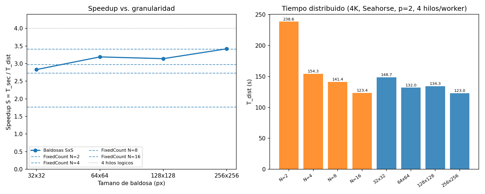
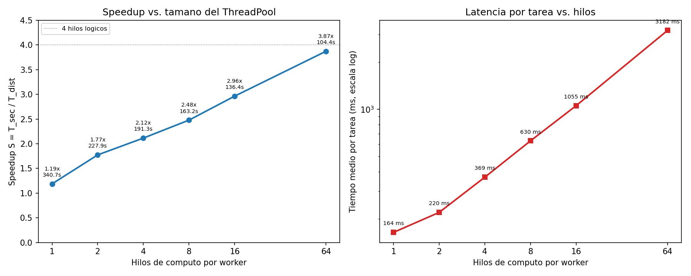
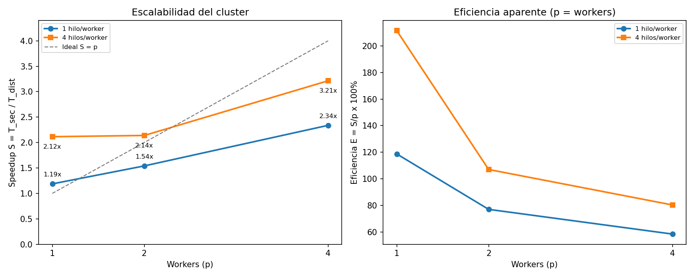
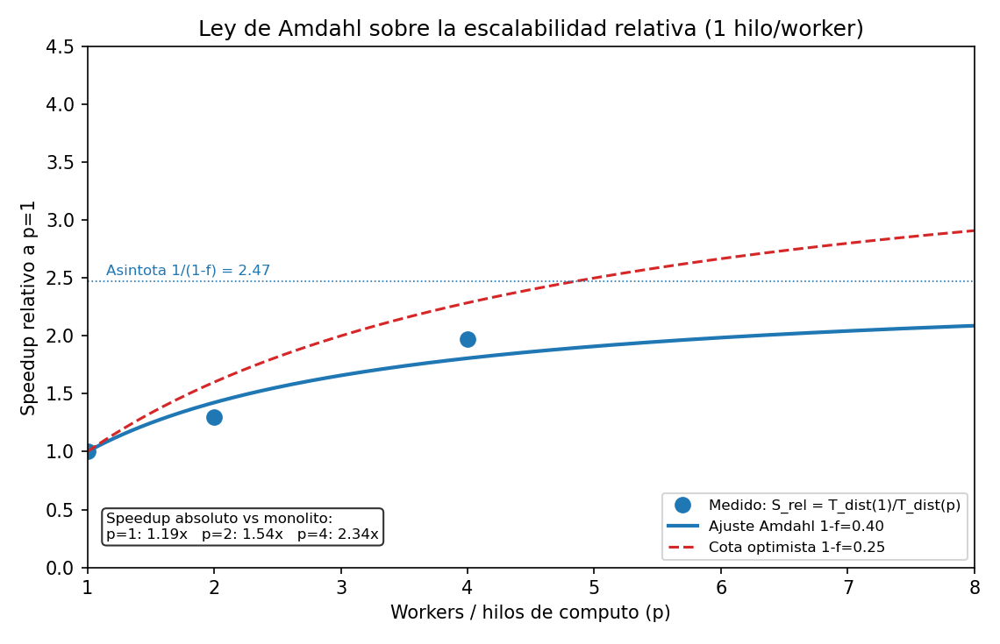
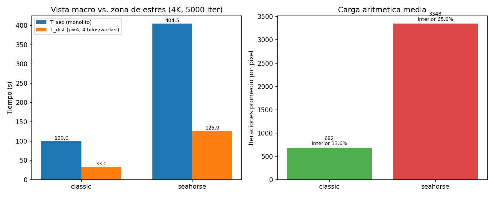

# Informe Técnico: Renderizado Distribuido de Fractales con Patrón Master-Worker

**Asignatura:** Computación en Internet I (09810 - TIC)  
**Programa:** Ingeniería de Sistemas / Ingeniería de Software  
**Facultad:** Facultad de Ingeniería, Diseño y Ciencias Aplicadas  
**Departamento:** Departamento de Computación y Sistemas Inteligentes (DCSI)  
**Institución:** Universidad Icesi, Cali, Colombia  
**Período:** 2026-2  
**Integrantes:** Sebastián Mejía Trujillo - A00410557  
**Repositorio:** https://github.com/Compu-1/taller-evaluativo-fractales-master-worker

---

## Resumen ejecutivo

Se implementó y ejecutó un clúster Master-Worker sobre ZeroC Ice para renderizar el conjunto de Mandelbrot en 4K UHD (3840 × 2160) con 5.000 iteraciones máximas por píxel. El clúster usa una bolsa de tareas concurrente, notificación asíncrona a los workers y consolidación incremental de resultados. La validación celda por celda contra el monolito fue **100 % exitosa** en las corridas de los Experimentos 2 y 3 y en la comparación `classic`; el harness del Experimento 1 mide tiempos, pero no ejecuta esa validación (limitación declarada en §2.4).

Los resultados principales son:

- El monolito tarda **404,5–421,3 s** en la región de estrés Seahorse Valley; el clúster reduce ese tiempo a **104,4 s** en la mejor configuración medida (un worker con 64 hilos, $S = 3{,}87$), cerca del límite de los 4 hilos lógicos de la máquina.
- La baldosa de **32 × 32** genera 8.160 tareas y es **12,7 % más lenta** que la de 64 × 64 (148,7 s vs. 132,0 s), evidencia del sobrecosto por mensaje y contención en el Maestro.
- La partición estática `FixedCount` con $N=2$ usa solo 2 de los 8 hilos de cómputo del clúster y obtiene $S=1{,}77$; con $N=16$ llena el pool y alcanza $S=3{,}41$. La bolsa dinámica de tareas de 64 × 64 mantiene los 8 hilos ocupados y balancea el trabajo entre workers (sumas de cómputo de 520,9 s y 521,0 s por worker).
- El pool de **64 hilos no degradó** el tiempo de pared: lo mejoró a 104,4 s, pero infló la latencia media por tarea **19,4 veces** (de 164 ms a 3.182 ms). El fenómeno se explica por ocultamiento de la latencia síncrona de RPC y por el uso completo de los 4 hilos lógicos, no por paralelismo real adicional.
- La fracción estrictamente secuencial efectiva, ajustada con la Ley de Amdahl sobre la escalabilidad controlada de 1 hilo por worker, es **$1-f \approx 0{,}40$** (rango 0,34–0,54 según el tramo). El valor incluye consolidación en el Maestro, logging por tarea, RPC y contención de CPU por co-localización.
- La vista `classic` tarda **100,0 s** y promedia **682,5 iteraciones/píxel**; Seahorse tarda **404,5 s** y promedia **3.347,8 iteraciones/píxel**. La vista macro es ~4 veces más rápida y oculta la necesidad de un clúster.

> **Nota de alcance:** todos los nodos se ejecutaron en la misma máquina física (localhost) para poder controlar el entorno. Esto convierte al Maestro, a los workers y al cliente en procesos que compiten por los mismos 2 núcleos físicos / 4 hilos lógicos. Los resultados de red deben interpretarse como una cota inferior del sobrecosto real de un clúster con máquinas separadas.

---

## 1. Objetivo y alcance

El objetivo del taller es diseñar, ejecutar y analizar un sistema de procesamiento distribuido bajo el patrón **Master-Worker** y el modelo **MIMD + NORMA (Shared-Nothing)**, aplicado al renderizado del conjunto de Mandelbrot. El sistema debía:

1. Particionar el problema con el patrón **Strategy** (franjas fijas y baldosas).
2. Implementar una bolsa de tareas concurrente con extracción dinámica (*work-pulling*).
3. Notificar asíncronamente a los workers y consolidar resultados en streaming.
4. Validar la imagen distribuida contra el monolito.
5. Medir y documentar los tres experimentos del protocolo: granularidad, tamaño del ThreadPool y escalabilidad del clúster.
6. Responder el cuestionario conceptual y declarar el uso ético de IAG.

El alcance de este informe incluye la ejecución real de los experimentos, las tablas de resultados, las gráficas de speedup, el análisis técnico y la evidencia cruda en `results/`.

---

## 2. Arquitectura y metodología

### 2.1 Arquitectura implementada

El flujo es el descrito en el taller:

```text
Cliente
  ├── calcula T_sec con un recorrido monohilo local
  ├── invoca master.renderFractal(config)
  ├── valida celda por celda contra la matriz local
  └── calcula S, E y guarda el PNG

Maestro (MasterServiceI)
  ├── aplica TaskPartitionStrategy
  ├── encola tareas en ConcurrentLinkedQueue
  ├── notifica a los WorkerObserver registrados
  ├── atiende pollTask() y reportResult()
  └── consolida los bloques en la matriz final y completa el future

Worker
  ├── se registra y queda en standby
  ├── al recibir notifyTasksAvailable() despierta su ThreadPool
  ├── cada hilo hace pollTask() → computeTile() → reportResult()
  └── repite hasta que la cola esté vacía
```

Los puntos de código relevantes son:

- Motor matemático: `common/src/main/java/co/icesi/fractal/core/MandelbrotCore.java:20`.
- Estrategias: `common/src/main/java/co/icesi/fractal/strategy/FixedCountPartitionStrategy.java` y `FixedTileSizePartitionStrategy.java`.
- Maestro y consolidación: `server/src/main/java/co/icesi/fractal/master/MasterServiceI.java:126` (sección crítica de consolidación) y `:141` (log por tarea).
- Worker y bucle de extracción: `worker/src/main/java/co/icesi/fractal/worker/WorkerMain.java:40` (pool) y `:111` (bucle `pollTask`).
- Cliente y validación: `client/src/main/java/co/icesi/fractal/client/ClientMain.java`.

### 2.2 Hardware y software

| Elemento | Especificación |
| :--- | :--- |
| CPU | Intel Core i3-10110U, 2 núcleos físicos, 4 hilos lógicos, 2,10 GHz base / 4,10 GHz turbo |
| RAM | 7,6 GB |
| Sistema operativo | Linux |
| Java | OpenJDK 17.0.19 |
| Middleware | ZeroC Ice 3.7.10 |
| Build | Gradle 8.6, proyecto multimódulo |
| Resolución | 3840 × 2160 (4K UHD), 8.294.400 píxeles |
| Iteraciones máximas | 5.000 |
| Región de estrés | `seahorse`: X ∈ [−0,75, −0,732222], Y ∈ [0,09, 0,10] (ajuste isométrico) |
| Región macro | `classic`: X ∈ [−2,0, 2,444444], Y ∈ [−1,25, 1,25] (ajuste isométrico) |

**Ajuste de aspecto.** El taller define `classic` con X ∈ [−2,0; 0,5] y `seahorse` con X ∈ [−0,75; −0,74], ambos con Y de altura 2,5 y 0,01, respectivamente. Para renderizar en 16:9 sin distorsión, el cliente conserva Y y extiende X: `classic` queda X ∈ [−2,0; 2,444444] y `seahorse` X ∈ [−0,75; −0,732222]. Esto añade espacio exterior y explica por qué las estadísticas de píxeles no coinciden exactamente con las cifras ilustrativas del enunciado (76 % de escapes <20 y >85 % de frontera); todas las comparaciones usan las matrices realmente renderizadas.

### 2.3 Definición de métricas

- $T_{sec}$: tiempo del recorrido monohilo secuencial en el cliente.
- $T_{dist}$: tiempo de pared de `master.renderFractal(config)`, medido en el cliente; incluye RPC, serialización, consolidación y retorno de la matriz.
- $S = T_{sec} / T_{dist}$.
- $E = (S/p) \times 100\%$, con $p$ = número de workers, tal como lo define el taller.
- $E_{hilo} = (S / \text{hilos de cómputo totales}) \times 100\%$: métrica complementaria para evidenciar el efecto de usar varios hilos por worker. Se incluye porque $E$ con $p$ = workers puede superar 100 % cuando cada worker es multihilo.
- $S_{rel}(p) = T_{dist}(1)/T_{dist}(p)$: speedup relativo al primer worker, usado para aislar la escalabilidad del clúster en la Ley de Amdahl.
- Los tiempos de cómputo por tarea que reporta el worker se miden con `System.currentTimeMillis` alrededor de `computeTile`; son tiempos de pared, no de CPU. Cuando hay más hilos que núcleos incluyen el desalojo de CPU, por lo que su suma puede superar el tiempo de pared del job multiplicado por los núcleos.

### 2.4 Configuración de las corridas

| Experimento | Workers | Hilos/worker | Estrategia | Repeticiones |
| :--- | :---: | :---: | :--- | :--- |
| 1. Granularidad | 2 | 4 | FixedCount N=2,4,8,16; tiles 32,64,128,256 | 1 por configuración |
| 2. ThreadPool | 1 | 1, 2, 4, 8, 16, 64 | tile 64 × 64 | 1; 4 hilos se repitió 2 veces |
| 3. Escalabilidad | 1, 2, 4 | 1 y 4 | tile 64 × 64 | p=2 con 1 hilo se repitió 2 veces |
| Vista macro | 4 | 4 | tile 64 × 64 | 1 |

Todas las corridas usaron 4K UHD, 5.000 iteraciones y la región Seahorse, salvo la comparación explícita con `classic`. Las matrices de referencia del monolito se guardaron en `results/raw/reference_*.bin` (con un sidecar `.tsec`) para reutilizar la validación sin repetir 7 minutos de línea base en cada corrida. A partir del Experimento 2, las corridas de los Experimentos 2 y 3 usaron esta caché; el Experimento 1 calculó su línea base con `ExperimentRunner` y `classic` calculó la suya con `ClientMain`. La optimización se implementó en `ClientMain` con los argumentos opcionales `--ref=<archivo>` y `--tsec=<ms>`; el comportamiento por defecto del cliente no cambió.

**Limitación de validación del Experimento 1.** `ExperimentRunner` mide `T_dist` para las 8 configuraciones de granularidad, pero no conserva la matriz ni ejecuta la comparación celda por celda; por eso el Experimento 1 no produce un `[VERIFICACION OK]` propio. La ruta de renderizado es la misma que validan los Experimentos 2/3 y `classic`, pero el informe no atribuye validación explícita a esas 8 corridas.

### 2.5 Reproducibilidad

```bash
# Compilar
./gradlew build

# Monolito 4K / 5000 iteraciones / Seahorse
./gradlew :monolith:runMonolith --args="3840 2160 5000 seahorse results/img/monolito_seahorse.png"

# Maestro
./gradlew :server:runMaster --args="10000"

# Workers (ejemplo: 2 workers con 4 hilos)
./gradlew :worker:runWorker --args="10001 Worker-1 localhost 10000 4"
./gradlew :worker:runWorker --args="10002 Worker-2 localhost 10000 4"

# Cliente de verificación única
./gradlew :client:runClient --args="localhost 10000 3840 2160 5000 1 64 seahorse results/img/distribuido.png"

# Matriz automatizada del Experimento 1
./gradlew :client:runExperiment --args="localhost 10000 3840 2160 5000 seahorse"
```

La caché de referencia es opcional:

```bash
# Primera corrida: calcula el monolito, guarda la matriz y su T_sec
client ... --ref=results/raw/reference_seahorse_4k_5000.bin

# Corridas siguientes: carga la referencia y reutiliza T_sec
client ... --ref=results/raw/reference_seahorse_4k_5000.bin --tsec=404508
```

Los logs crudos, CSV y figuras están en `results/logs/`, `results/data/` y `results/img/`. El script `scripts/generate_report_assets.py` consolida los datos de las corridas y regenera los CSV y las gráficas; las métricas por worker y las estadísticas de las matrices se extraen directamente de los logs y de los archivos binarios.

---

## 3. Resultados experimentales

### 3.1 Experimento 1: granularidad y sobrecosto de red

**Configuración:** 4K UHD, 5.000 iteraciones, Seahorse, $p=2$ workers, 4 hilos por worker (8 hilos de cómputo sobre 4 hilos lógicos), $T_{sec}=421.337$ ms. Este $T_{sec}$ es 4,2 % mayor que el de los Experimentos 2/3 (404.508 ms) porque son corridas separadas; la diferencia está dentro de la variabilidad declarada y no afecta las comparaciones internas de cada experimento.

| Estrategia | Parámetro | Tareas creadas | $T_{sec}$ (ms) | $T_{dist}$ (ms) | $S$ | $E$ ($p=2$) | $E_{hilo}$ (8 hilos) |
| :--- | :---: | :---: | ---: | ---: | ---: | ---: | ---: |
| FixedCount (franjas) | N = 2 | 2 | 421.337 | 238.567 | 1,77× | 88,3 % | 22,1 % |
| FixedCount (franjas) | N = 4 | 4 | 421.337 | 154.264 | 2,73× | 136,6 % | 34,1 % |
| FixedCount (franjas) | N = 8* | 8 | 421.337 | 141.394 | 2,98× | 149,0 % | 37,3 % |
| FixedCount (franjas) | N = 16 | 16 | 421.337 | 123.394 | 3,41× | 170,7 % | 42,6 % |
| FixedTileSize (baldosas) | 32 × 32 | 8.160 | 421.337 | 148.730 | 2,83× | 141,6 % | 35,4 % |
| FixedTileSize (baldosas) | 64 × 64 | 2.040 | 421.337 | 131.989 | 3,19× | 159,6 % | 39,9 % |
| FixedTileSize (baldosas) | 128 × 128 | 510 | 421.337 | 134.318 | 3,14× | 156,8 % | 39,3 % |
| FixedTileSize (baldosas) | 256 × 256 | 135 | 421.337 | 123.022 | 3,42× | 171,2 % | 42,8 % |

\* Fila complementaria; el taller lista N=2, 4 y 16. Se incluye N=8 para completar la curva.



**Lectura de los datos:**

1. **El grano fino colapsa por sobrecosto, no por falta de CPU.** La baldosa de 32 × 32 crea 8.160 tareas (16.320 RPC de `pollTask` + `reportResult`) y tarda 148,7 s; la de 64 × 64 crea 2.040 tareas (4.080 RPC) y tarda 132,0 s. La diferencia es **16,7 s (12,7 %)** a favor de 64 × 64, aunque ambas procesan exactamente los mismos 8.294.400 píxeles. El costo fijo por mensaje (serialización binaria de Slice, encabezados TCP, ida y vuelta, logging y sección crítica del Maestro) domina cuando las tareas son demasiado pequeñas.
2. **El "grano óptimo" de 64 × 64 no fue el mínimo absoluto en esta máquina.** La baldosa de 256 × 256 (135 tareas) y N=16 (16 franjas) fueron marginalmente más rápidas (~123 s). En Seahorse la carga es relativamente uniforme a esta escala, y con solo 8 hilos de cómputo 135 tareas bastan para mantenerlos ocupados; reducir el número de RPC ayuda. La baldosa de 256 × 256 fue **6,8 % más rápida** que la de 64 × 64 (equivalentemente, 64 × 64 fue 7,3 % más lenta), una diferencia dentro de la variabilidad de una corrida única. Para los Experimentos 2 y 3 se eligió 64 × 64 porque genera suficientes tareas para estudiar un pool de hasta 64 hilos y porque es la referencia explícita del taller; no porque haya sido el mínimo absoluto.
3. **La partición estática mejora al aumentar N, pero por una razón distinta.** Con N=2 solo hay 2 tareas y cada una se ejecuta en un solo hilo: el clúster usa 2 de sus 8 hilos de cómputo. Con N=16 hay 16 tareas y los 8 hilos se ocupan (dos tareas por hilo), por lo que el tiempo baja a 123,4 s. La estrategia estática no es intrínsecamente mala si $N \gg$ hilos, pero es frágil: depende de que el número de tareas y la densidad de cada franja se ajusten al clúster.
4. **La eficiencia aparente supera 100 %** porque $E=S/p$ usa $p=2$ workers, pero cada worker tiene 4 hilos. La columna $E_{hilo}$ muestra la eficiencia real por hilo: 39,9 % para 64 × 64 y 42,8 % para 256 × 256. Es decir, el clúster no aprovecha perfectamente los 8 hilos; el Maestro, el logging y la contención de CPU consumen parte del tiempo.

### 3.2 Experimento 2: concurrencia y saturación del ThreadPool

**Configuración:** 4K UHD, 5.000 iteraciones, Seahorse, un worker, tile 64 × 64, $T_{sec}=404.508$ ms (monolito medido en la corrida A).

| Configuración | Hilos | $T_{dist}$ (ms) | $S$ | $E$ ($p=1$ worker) | $E_{hilo}$ ($S$/hilos) | Tiempo medio por tarea (ms) |
| :--- | :---: | ---: | ---: | ---: | ---: | ---: |
| A: monohilo puro | 1 | 340.743 | 1,19× | 118,7 % | 118,7 % | 164,3 |
| B: dos hilos | 2 | 227.950 | 1,77× | 177,4 % | 88,7 % | 220,3 |
| C: cuatro hilos | 4 | 191.292* | 2,12× | 211,5 % | 52,9 % | 369,4 |
| E: ocho hilos** | 8 | 163.161 | 2,48× | 247,9 % | 31,0 % | 629,8 |
| F: dieciséis hilos** | 16 | 136.424 | 2,96× | 296,5 % | 18,5 % | 1.055,4 |
| D: sesenta y cuatro hilos | 64 | 104.425 | 3,87× | 387,4 % | 6,1 % | 3.182,2 |

\* Promedio de dos corridas de 4 hilos: 188.327 ms y 194.257 ms.  
\** Filas complementarias para caracterizar la curva; el taller pide A, B, C y D.

El caso de 1 hilo tiene $S=1{,}19>1$ porque el monolito del cliente se ejecuta en frío y el worker en una JVM separada con JIT más favorable; no es paralelismo. Por eso las comparaciones de escalabilidad se hacen entre configuraciones de hilos y, en el Experimento 3, con $S_{rel}$.



**Lectura de los datos:**

1. **De 1 a 4 hilos la ganancia es sublineal.** El worker con 1 hilo tarda 340,7 s; con 2 hilos, 228,0 s (1,49×); con 4 hilos, 191,3 s (1,78×). La máquina tiene 2 núcleos físicos y 4 hilos lógicos; el hyperthreading no duplica el rendimiento aritmético, y además el worker compite con el Maestro y con el cliente por CPU.
2. **El pool de 64 hilos no degradó el tiempo de pared, pero sí la latencia individual.** El tiempo medio por tarea pasó de 164 ms (1 hilo) a 3.182 ms (64 hilos): un factor **19,4×**. La suma de los tiempos de pared de cómputo reportados por las tareas pasó de 335.193 ms a 6.491.624 ms; como son tiempos de pared y no de CPU, con 64 hilos la suma supera ampliamente el tiempo de pared del job multiplicado por los 4 núcleos lógicos. Esto es la firma clásica de la alternancia de contexto: 64 hilos ejecutables sobre 4 hilos lógicos, cada tarea espera CPU, se pierden cachés y TLB, y el planificador reparte quanta.
3. **¿Por qué entonces 64 hilos fue más rápido?** Porque el cuello de botella de las configuraciones de 1–4 hilos no era solo la CPU, sino la **latencia síncrona de RPC**. Cada hilo hace `pollTask`, calcula una baldosa pequeña y hace `reportResult`; mientras espera la respuesta del Maestro, el hilo está bloqueado y su núcleo queda ocioso. Con 64 hilos, mientras unos esperan RPC, otros calculan, de modo que los 4 hilos lógicos se mantienen ocupados. El throughput agregado mejora hasta acercarse al límite de 4 hilos lógicos ($S=3{,}87$), pero a costa de una latencia por tarea muy alta y de un uso de CPU ineficiente por hilo ($E_{hilo}=6{,}1\%$).
4. **La lección arquitectónica:** sobredimensionar el pool puede ser útil para ocultar latencia de E/S o RPC, pero no sustituye núcleos. Si el cómputo fuera puramente CPU-bound y sin esperas de red, 64 hilos degradaría el tiempo de pared. En este sistema, la latencia del Maestro y la contención de la máquina local hicieron que el sobredimensionamiento “funcionara” en throughput, pero no en eficiencia.

### 3.3 Experimento 3: escalabilidad del clúster

Para que $p$ (workers) coincida con el número de hilos de cómputo y la Ley de Amdahl sea aplicable, se fijó **1 hilo por worker** en la primera serie. En la segunda serie se usó la configuración de **4 hilos por worker** (la mejor del Experimento 2 para un worker) para observar el efecto de añadir nodos cuando el CPU ya está saturado. Todas las corridas usan tile 64 × 64 y $T_{sec}=404.508$ ms.

**Serie A: 1 hilo por worker (p = hilos totales)**

| Workers $p$ | $T_{dist}$ (ms) | $S$ absoluto | $E = S/p$ | $S_{rel}=T_{dist}(1)/T_{dist}(p)$ |
| :---: | ---: | ---: | ---: | ---: |
| 1 | 340.743 | 1,19× | 118,7 % | 1,00× |
| 2 | 262.611* | 1,54× | 77,0 % | 1,30× |
| 4 | 173.043 | 2,34× | 58,4 % | 1,97× |

\* Se midió dos veces: 295.465 ms y 262.611 ms. Se reporta la segunda, con el clúster ya estabilizado; la primera evidencia la variabilidad por co-localización y calentamiento de JVM.

El $S$ absoluto de $p=1$ es 1,19× por la misma razón de línea base del Experimento 2; la comparación de escalabilidad usa $S_{rel}$.

**Serie B: 4 hilos por worker (hilos totales = 4p)**

| Workers $p$ | Hilos totales | $T_{dist}$ (ms) | $S$ absoluto | $E = S/p$ | $E_{hilo}=S/(4p)$ | $S_{rel}$ |
| :---: | :---: | ---: | ---: | ---: | ---: | ---: |
| 1 | 4 | 191.292* | 2,12× | 211,5 % | 52,9 % | 1,00× |
| 2 | 8 | 189.074 | 2,14× | 107,0 % | 26,7 % | 1,01× |
| 4 | 16 | 125.866 | 3,21× | 80,3 % | 20,1 % | 1,52× |

\* Promedio de dos corridas de 4 hilos (188.327 ms y 194.257 ms).



Nota: la línea ideal $S=p$ corresponde a la serie de 1 hilo/worker; la serie de 4 hilos/worker parte de 4 hilos y por eso puede superar $S=p$.

**Lectura de los datos:**

1. **Con 1 hilo por worker, añadir workers ayuda pero de forma sublineal.** Pasar de 1 a 2 workers mejora 1,30×; de 1 a 4 workers, 1,97×. La máquina solo tiene 2 núcleos físicos / 4 hilos lógicos, y el Maestro, los dos o cuatro JVM de workers y el cliente compiten por ellos. El Maestro además consolida cada baldosa bajo un lock global y escribe una línea de log por tarea, lo que consume CPU y serializa parte del trabajo.
2. **Con 4 hilos por worker, el primer worker ya satura los 4 hilos lógicos.** Añadir un segundo worker (8 hilos totales) no mejora el tiempo: 189,1 s vs. 191,3 s ($S_{rel}=1{,}01$). Añadir dos workers más (16 hilos totales) mejora a 125,9 s ($S_{rel}=1{,}52$), de nuevo por ocultamiento de latencia RPC, no por más capacidad aritmética. La eficiencia por hilo cae de 52,9 % a 20,1 %.
3. **El clúster está limitado por el hardware, no por el número de nodos.** En una máquina de 2 núcleos físicos, 4 workers no pueden dar un speedup de 4×. El mejor resultado absoluto fue el worker único con 64 hilos ($S=3{,}87$), seguido de 4 workers × 4 hilos ($S=3{,}21$). En un clúster real con máquinas separadas, el Maestro no competiría por CPU con los workers y la escalabilidad sería mejor; esa es la principal limitación de esta medición.

### 3.4 Ley de Amdahl

Para estimar la fracción estrictamente secuencial se usó la serie controlada de **1 hilo por worker** y el modelo:

$$
T(p) = T(1)\left[(1-f) + \frac{f}{p}\right]
\quad\Longrightarrow\quad
S_{rel}(p) = \frac{1}{(1-f) + f/p}.
$$

Con $p=1,2,4$ y $T(1)=340.743$ ms, $T(2)=262.611$ ms, $T(4)=173.043$ ms, el ajuste por mínimos cuadrados da:

$$
f \approx 0{,}595 \qquad\Longrightarrow\qquad 1-f \approx 0{,}405 \approx 40\%.
$$

| Tramo usado | $f$ ajustado | $1-f$ | Comentario |
| :--- | ---: | ---: | :--- |
| $p=1 \to 2$ | 0,459 | 0,541 | El tramo más pesimista; usa la repetición estabilizada de p=2 (la primera corrida fue más lenta) |
| $p=1 \to 4$ | 0,656 | 0,344 | Estimación más optimista del tramo controlado |
| Ajuste $p=1,2,4$ | 0,595 | 0,405 | Valor central reportado |
| 64 hilos (un worker) tratado como $p=64$ | 0,754 | 0,246 | Cota optimista; el sobredimensionamiento oculta latencia |



La curva y los puntos usan $S_{rel}=T_{dist}(1)/T_{dist}(p)$; el recuadro muestra los $S$ absolutos contra el monolito.

**Interpretación:** la fracción serial efectiva de **~40 %** no es solo la copia de la matriz en el Maestro. Incluye:

- La consolidación sincronizada de cada baldosa en `MasterServiceI.reportResult` (`synchronized (consolidationLock)`), que serializa la escritura en la matriz final.
- El logging por tarea en la consola del Maestro, que con 2.040 tareas es una cantidad significativa de E/S y de contención.
- La latencia de RPC y la serialización binaria de Slice.
- La contención de CPU por co-localizar Maestro, workers y cliente en la misma máquina.
- El calentamiento de JIT, GC y la frecuencia variable del CPU.

El ajuste de Amdahl con $1-f=0{,}405$ predice una asíntota relativa de $1/(1-f)=2{,}47×$. El $S_{rel}$ medido con 4 workers de 1 hilo fue $1{,}97×$ ($S$ absoluto $2{,}34×$), por debajo de la asíntota y razonablemente cerca del valor ajustado para $p=4$ ($1{,}81×$). Sin embargo, el worker único de 64 hilos alcanzó $S=3{,}87×$, por encima de esa asíntota. Esto demuestra que **la fracción serial no es constante**: al aumentar la concurrencia se oculta latencia y cambia el cuello de botella, por lo que la Ley de Amdahl es una aproximación útil pero no una predicción exacta para este sistema co-localizado.

### 3.5 Vista macro (`classic`) vs. zona de estrés (`seahorse`)

| Región | $T_{sec}$ (ms) | $T_{dist}$ (ms)* | $S$ | $E$ ($p=4$) | Iteraciones promedio/px | Píxeles interiores | Píxeles que escapan en <20 iter |
| :--- | ---: | ---: | ---: | ---: | ---: | ---: | ---: |
| `classic` | 99.958 | 33.016 | 3,03× | 75,7 % | 682,5 | 13,56 % | 84,31 % |
| `seahorse` | 404.508 | 125.866 | 3,21× | 80,3 % | 3.347,8 | 64,95 % | 0,00 % |

\* $T_{dist}$ con 4 workers × 4 hilos, tile 64 × 64, para ambas regiones.

Las estadísticas de `classic` corresponden a la vista 16:9 extendida (X hasta 2,444444), no al rango nominal 1:1 del enunciado; por eso el porcentaje de escape es mayor y la media de iteraciones menor que las cifras ilustrativas del PDF. La comparación `classic` vs. `seahorse` usa las dos matrices renderizadas por el mismo cliente.



La vista `classic` es **4,05× más rápida** en el monolito y su media de iteraciones por píxel es **4,90× menor** que la de Seahorse. El 84,31 % de sus píxeles escapa en menos de 20 iteraciones, mientras que en Seahorse ningún píxel escapa tan rápido y el 64,95 % agota las 5.000 iteraciones. El speedup distribuido es parecido (~3×), pero el tiempo absoluto ahorrado es mucho mayor en Seahorse: ~279 s vs. ~67 s. Esa es la razón por la que la vista macro oculta la necesidad del clúster.

---

## 4. Cuestionario de análisis conceptual y discusión técnica

### 4.1 La trampa del espacio vacío vs. la zona de estrés

**¿Por qué el cómputo monohilo en `classic` parece rápido a pesar de fijar 5.000 iteraciones?** Porque 5.000 es un **límite superior**, no el trabajo real. En `classic`, el 84,31 % de los píxeles escapa en menos de 20 iteraciones y el promedio es 682,5 iteraciones/píxel. La función de escape `z_{n+1}=z_n^2+c` termina en cuanto `|z|^2 > 4`; la mayoría de los píxeles de la vista panorámica están lejos del conjunto y escapan casi de inmediato. El costo por píxel es, en promedio, ~4,9 veces menor que en Seahorse (la media de Seahorse es ~4,9 veces la de `classic`).

**Contraste con Seahorse:** el promedio es 3.347,8 iteraciones/píxel, el 64,95 % de los píxeles agota las 5.000 iteraciones y ningún píxel escapa en menos de 20. El monolito tarda 404,5 s frente a 100,0 s de `classic`: **4,05×** más. La carga es intrínsecamente heterogénea y mucho más densa.

**¿Por qué la vista macro oculta la necesidad de un clúster?** Porque el tiempo secuencial ya es “aceptable” (~100 s) y el ahorro absoluto de paralelizar es pequeño (~67 s). En cambio, en Seahorse el monolito tarda ~7 minutos y el clúster lo reduce a ~2 minutos; el ahorro absoluto (~279 s) justifica la complejidad. Además, en `classic` el cómputo por píxel es tan bajo que el sobrecosto de RPC pesa más en proporción: el clúster sigue ganando ~3×, pero no es la diferencia dramática que se observa en la zona de estrés. La vista macro es una **trampa de benchmarking**: mide un problema que no representa la carga real del fractal.

### 4.2 Colapso por grano fino vs. sobrecosto de red

En 4K, la baldosa de 32 × 32 genera:

$$
\left\lceil \frac{3840}{32} \right\rceil \times \left\lceil \frac{2160}{32} \right\rceil
= 120 \times 68 = 8.160 \text{ tareas}.
$$

Cada tarea implica un `pollTask` y un `reportResult`, es decir, **16.320 RPC**. Con 64 × 64 son 2.040 tareas y **4.080 RPC**: cuatro veces menos mensajes. El tiempo distribuido medido fue 148,7 s vs. 132,0 s, un **12,7 %** peor para 32 × 32.

El costo de la granularidad fina se descompone así:

1. **Serialización binaria en Slice:** cada `TileResult` incluye la matriz de píxeles. Una baldosa de 32 × 32 son 1.024 enteros (~4 KB); una de 64 × 64 son 4.096 enteros (~16 KB). Aunque el payload total es el mismo (8,3 M enteros), el número de cabeceras, frames y llamadas es 4× mayor. El costo fijo por mensaje (marshaling/unmarshaling, creación de secuencias, checks) se paga 4× más veces.
2. **Encabezados TCP y latencia de ida y vuelta:** cada RPC tiene su framing de Ice, su request/response y su contexto. En localhost la latencia es baja, pero en una red real con RTT de 0,1–1 ms y varios nodos, 16.320 RPC añaden un sobrecosto mucho mayor. Los 12,7 % medidos en localhost son una **cota inferior** del efecto en red.
3. **Contención en la cola del Maestro:** `ConcurrentLinkedQueue` es lock-free para `poll`, pero `reportResult` entra a una sección crítica (`synchronized`) para consolidar cada baldosa y además escribe un log por tarea. Con 8.160 tareas hay 4× más entradas a la sección crítica y 4× más líneas de log. El log de consola es especialmente costoso porque `System.out` está sincronizado.
4. **Sobrecosto por tarea en el worker:** cada tarea asigna su matriz `int[tileHeight][tileWidth]`, recorre el bloque y llama a `computePoint`. Con tareas muy pequeñas, el costo de setup y la falta de localidad de caché pesan más. La suma de los tiempos de pared de cómputo de los dos workers fue 1.137,0 s (32 × 32) vs. 1.041,9 s (64 × 64); por worker, ~568,5 s vs. ~521,0 s. Aunque el trabajo matemático total es el mismo, el grano fino añade ~9,1 % de tiempo de cómputo medido.
5. **Balanceo y fluctuación:** con 8.160 tareas el Maestro y los workers intercambian más mensajes y el jitter de scheduling se amplifica. La cola se vacía y se llena más rápido; los hilos hacen más transiciones.

**Conclusión:** el grano fino no colapsa por falta de paralelismo, sino porque el **costo por mensaje** y la **contención del Maestro** crecen con el número de tareas. La curva es en U: 32 × 32 paga demasiados RPC; 256 × 256 paga menos RPC pero tiene menos tareas para balancear; 64 × 64–128 × 128 es la zona de compromiso. En esta máquina, 256 × 256 fue marginalmente mejor porque el CPU es pequeño y la carga de Seahorse es relativamente uniforme; en un clúster grande con carga más heterogénea, 64 × 64 sería más robusto.

### 4.3 Fracaso de la partición estática

La partición `FixedCount` divide la altura en $N$ franjas. En nuestro clúster de 2 workers × 4 hilos = 8 hilos de cómputo:

| Configuración | Tareas | Hilos ocupados | $T_{dist}$ (ms) | Worker-1: tareas / cómputo | Worker-2: tareas / cómputo |
| :--- | :---: | :---: | ---: | :--- | :--- |
| FixedCount N=2 | 2 | 2 de 8 | 238.567 | 1 / 237.477 ms | 1 / 224.040 ms |
| FixedCount N=4 | 4 | 4 de 8 | 154.264 | 2 / 303.536 ms | 2 / 286.511 ms |
| FixedCount N=8 | 8 | 8 de 8 | 141.394 | 4 / 526.094 ms | 4 / 512.940 ms |
| FixedCount N=16 | 16 | 8 de 8 (2 olas) | 123.394 | 8 / 450.274 ms | 8 / 484.744 ms |
| Tile 64 × 64 | 2.040 | 8 de 8 | 131.989 | 961 / 520.948 ms | 1.079 / 520.963 ms |

**¿Por qué ocurre el desbalance?** Hay dos efectos distintos:

1. **Subutilización por granularidad:** con N=2, en esta corrida cada worker tomó una franja y la calculó con **un solo hilo**, porque una tarea no se subdivide dentro del worker. El worker tiene 4 hilos, pero solo uno recibe trabajo; los otros tres hacen `pollTask`, encuentran la cola vacía y terminan. El clúster usa 2 de 8 hilos (25 %). Como solo hay 2 tareas, no hay garantía de que cada worker tome una: un worker podría tomarlas ambas y empeorar la utilización. Con N=4 ocurre lo mismo a menor escala: 4 de 8 hilos (50 %) en esta corrida. Con N=8 se llenan los 8 hilos; con N=16 hay dos olas.
2. **Desbalance entre franjas:** las franjas tienen distinta densidad. En N=2, las sumas de cómputo difieren ~6 % (237,5 s vs. 224,0 s); en N=16, ~7,6 % (450,3 s vs. 484,7 s). No es un desbalance catastrófico en esta región, pero es suficiente para que un worker termine antes y quede ocioso mientras el otro sigue. Si la franja más densa cayera en un solo worker, el tiempo de pared sería el del worker más lento y los demás quedarían idle.

**Cómo lo resuelve Bag of Tasks:** la estrategia de baldosas crea 2.040 tareas pequeñas y cada hilo pide la siguiente cuando termina. El worker más rápido toma más tareas: en la corrida de 64 × 64, Worker-1 procesó 961 tareas y Worker-2 1.079, pero sus sumas de cómputo fueron casi idénticas (520.948 ms vs. 520.963 ms, diferencia <0,01 %). La cola dinámica convierte el desbalance en una diferencia de **número de tareas**, no en tiempo ocioso. Esa es la superioridad del patrón Bag of Tasks: no requiere conocer la densidad de antemano y se adapta a la heterogeneidad.

**Matiz:** N=16 logró 123,4 s, casi igual que la mejor baldosa (123,0 s). La partición estática puede ser competitiva si $N$ es mucho mayor que el número de hilos y la carga es relativamente uniforme. Pero es frágil: si cambia la región, el número de workers o la heterogeneidad, el balance se rompe. La bolsa dinámica es más robusta y no necesita recompilar ni reconfigurar $N$.

### 4.4 Puntos de quiebre del hardware y la memoria

#### 4.4.1 Precisión numérica de `double`

`double` IEEE 754 tiene 53 bits de mantisa, ~15–17 dígitos decimales significativos y un épsilon de máquina de $2{,}22 \times 10^{-16}$. En Mandelbrot, la iteración amplifica el error de redondeo y, sobre todo, la **cuantización de las coordenadas**: si dos píxeles vecinos se redondean al mismo `double`, el renderizado produce el mismo valor para ambos.

El límite práctico aparece cuando el ancho de la vista se acerca a la precisión relativa de las coordenadas. Para coordenadas del orden de 0,75, el ULP es ~$1{,}1 \times 10^{-16}$. Una vista de ancho $10^{-15}$ tiene solo ~10 pasos de máquina; a magnificaciones de **$10^{13}$–$10^{15}$** respecto de la vista inicial, el detalle se pierde. Los artefactos típicos son:

- Regiones planas y bloques de color uniforme (“pixelación” o *blockiness*).
- Pérdida de filamentos y de estructura fina en la frontera.
- Falsos interiores negros donde el punto debería escapar.
- Bandas y asimetrías que no corresponden al fractal real.
- Cambios abruptos de iteración entre píxeles vecinos.

**Impacto de reemplazar `double` por `BigDecimal`:** `BigDecimal` permite precisión arbitraria y resolvería la cuantización, pero su aritmética es software, con asignación de objetos y sin FPU. El costo por operación puede ser decenas o cientos de veces mayor, y el consumo de memoria crece con la precisión. Para 4K y 5.000 iteraciones, el tiempo pasaría de minutos a horas o días, y el clúster quedaría dominado por el cómputo de precisión arbitraria. Alternativas prácticas: **perturbation theory** con una órbita de referencia en alta precisión, aritmética **double-double**, o GPU con precisión extendida. En este taller no se alcanza el límite de `double`: Seahorse tiene un ancho de $\approx 1{,}8 \times 10^{-2}$, muy lejos de $10^{-15}$.

#### 4.4.2 Saturación de memoria a 16K y 32K

Cada matriz de iteraciones usa `int` de 4 bytes por píxel. Los tamaños son:

| Resolución | Píxeles | Una matriz `int[][]` | Dos matrices (cliente) | `BufferedImage` RGB | Total aproximado |
| :--- | ---: | ---: | ---: | ---: | ---: |
| 4K (3840 × 2160) | 8,29 M | 33,2 MB | 66,4 MB | 33,2 MB | ~100 MB |
| 8K (7680 × 4320) | 33,18 M | 132,7 MB | 265,4 MB | 132,7 MB | ~400 MB |
| 16K (15360 × 8640) | 132,71 M | 530,8 MB | 1.061,7 MB | 530,8 MB | ~1,6 GB |
| 32K (30720 × 17280) | 530,84 M | 2.123,4 MB | 4.246,7 MB | 2.123,4 MB | ~6,4 GB |

Además de las matrices, el cliente y el Maestro mantienen copias para la serialización de Ice, la cola de resultados y el `BufferedImage` que se usa para escribir el PNG. El heap máximo por defecto de la JVM es aproximadamente $1/4$ de la RAM (≈1,9 GB en esta máquina). Por tanto:

- **16K:** ~1,6 GB de datos + overhead de JVM, serialización y PNG. Es **limítrofe**; con el heap por defecto (~1,9 GB) puede fallar por `OutOfMemoryError: Java heap space`, y con `-Xmx` mayor compite con el sistema operativo.
- **32K:** ~6,4 GB de datos + overhead, por encima de los 7,6 GB de RAM y muy por encima del heap por defecto. **Falla con `java.lang.OutOfMemoryError: Java heap space`** (o `GC overhead limit exceeded` si el GC entra en thrashing). Si se intentara una única estructura contigua de más de $2^{31}-1$ elementos, aparecería `Requested array size exceeds VM limit`; en este caso las matrices son `int[][]` con filas de 30.720 enteros, así que el error esperado es heap space.

**Mitigaciones:** no mantener dos matrices completas (validar por streaming o por tiles), escribir el PNG por bloques, usar `short`/`int` comprimido si el rango de iteraciones lo permite, evitar la copia de serialización con transferencia por referencia o archivos, y separar el Maestro de los workers para no sumar heaps. Aun así, 32K es un problema de memoria antes que de CPU.

### 4.5 Límites del ThreadPool y Ley de Amdahl

**¿Qué ocurrió al elevar el pool a 64 hilos?** El tiempo de pared mejoró de 340,7 s (1 hilo) a 104,4 s (64 hilos), $S=3{,}87$, pero la latencia media por tarea se infló de 164 ms a 3.182 ms (**19,4×**) y la suma de tiempos de pared de cómputo pasó de 335 s a 6.491 s. Es el fenómeno de **alternancia de contexto**: 64 hilos ejecutables sobre 4 hilos lógicos; el planificador reparte quanta, cada tarea espera CPU, se pierden cachés y TLB, y el overhead de scheduler crece. El throughput agregado mejora porque se oculta la latencia síncrona de RPC y se mantienen ocupados los 4 hilos lógicos, pero la eficiencia por hilo cae a 6,1 %. En un workload puramente CPU-bound, 64 hilos habría degradado el tiempo; aquí el cuello era la espera de RPC.

**Cálculo de $1-f$:** con la serie controlada de 1 hilo por worker ($p=1,2,4$), el ajuste da $1-f \approx 0{,}40$ (40 %). El rango según el tramo es 0,34–0,54. La asíntota teórica es $1/(1-f)=2{,}47×$; el $S_{rel}$ medido con 4 workers de 1 hilo fue $1{,}97×$ ($S$ absoluto $2{,}34×$), por debajo de la asíntota. El worker único de 64 hilos ($S=3{,}87$) supera esa asíntota porque la fracción serial no es constante: al ocultar latencia, el cuello de botella cambia y el modelo de Amdahl deja de ser exacto.

**¿De dónde sale la fracción secuencial?** De la consolidación en el Maestro (`synchronized (consolidationLock)`), el logging por tarea, la serialización de Slice, la latencia de RPC, el calentamiento de JIT/GC y la contención de CPU por co-localización. El Maestro consolida 2.040 bloques de 64 × 64; cada consolidación es pequeña, pero el lock y el log se ejecutan 2.040 veces. Para reducirlo: logging asíncrono o por muestreo, consolidación en regiones disjuntas sin lock global, batching de resultados y separar el Maestro de los workers.

---

## 5. Bitácora de uso ético de IAG (Nivel 3)

**Herramienta utilizada:** asistente de IAG (opencode), sesión del 26 de octubre de 2026.  
**Política:** Nivel 3: Colaboración Asistida.  
**Declaración:** la IAG se utilizó como apoyo para explicar el enunciado, aclarar conceptos y pasos de implementación, y mejorar la redacción y presentación del informe. El equipo realizó la ejecución de las pruebas, revisó los resultados y asumió las decisiones técnicas. Las cifras provienen de los logs y matrices almacenados en `results/`; no fueron inventadas.

### 5.1 Prompts clave

| # | Prompt (resumen) | Uso | Verificación |
| :---: | :--- | :--- | :--- |
| 1 | “Explícame qué pide el taller y cómo organizar la solución.” | Comprensión del enunciado | Se contrastó cada sección con el PDF |
| 2 | “Explícame cómo funcionan el patrón Master-Worker, el Bag of Tasks y el Work-Pulling.” | Apoyo conceptual | Se revisó contra el código del proyecto |
| 3 | “Ayúdame a entender cómo calcular $S$, $E$ y la fracción secuencial de Amdahl.” | Apoyo en el análisis | Cálculos revisados con los logs y las tablas |
| 4 | “Apóyame a redactar y ordenar el informe para que sea claro.” | Redacción y estructura | Revisión y ajuste del equipo |
| 5 | “Revisa la redacción y la consistencia del informe.” | Corrección de estilo | Validación final del equipo |

### 5.2 Asistencia recibida y justificación crítica

- **Comprensión del taller:** la IAG explicó el alcance, los tres experimentos y el cuestionario; el equipo contrastó cada punto con el PDF y definió la implementación.
- **Apoyo conceptual:** la IAG explicó el patrón Master-Worker, el Bag of Tasks, la granularidad, el costo de RPC, la Ley de Amdahl y los límites de memoria; el equipo revisó esas explicaciones contra el código y los datos.
- **Redacción y presentación:** la IAG ayudó a ordenar las secciones, mejorar la claridad y unificar el formato; el equipo revisó las cifras, las referencias y las conclusiones.
- **Depuración:** la IAG ayudó a interpretar errores y a explicar alternativas de solución; el equipo revisó, aplicó y verificó los cambios.
- **Verificación:** el equipo comprobó que las tablas y figuras coincidieran con los logs; la IAG no generó datos ni sustituyó la ejecución o validación experimental.
- **Límites:** todas las pruebas fueron en localhost; no se dispuso de un clúster físico separado, lo que se declara al interpretar los resultados de red como cota inferior.

### 5.3 Compromisos

1. No se presentan como propios los textos generados sin revisión.
2. No se ocultan resultados que contradicen la hipótesis inicial (por ejemplo, los 64 hilos).
3. Los datos crudos quedan disponibles para auditoría en `results/logs/`.
4. Las decisiones de diseño y las conclusiones son responsabilidad del equipo.

---

## 6. Conclusiones

1. **El clúster funciona y es correcto en las corridas validadas.** Las corridas de los Experimentos 2/3 y `classic` produjeron una imagen 100 % idéntica al monolito, celda por celda; el Experimento 1 no ejecuta esa validación (limitación declarada en §2.4).
2. **La granularidad es una decisión de ingeniería, no un detalle.** 32 × 32 genera 8.160 tareas y es 12,7 % más lenta que 64 × 64 por sobrecosto de RPC, serialización, logging y contención. 256 × 256 fue marginalmente más rápida en esta máquina, pero 64 × 64 es más robusta para pools grandes y cargas heterogéneas.
3. **La partición estática es frágil.** Con N=2 solo se usan 2 de 8 hilos; con N=16 se llenan los 8 y el tiempo baja a 123,4 s. La bolsa dinámica de tareas mantiene los hilos ocupados y balancea la carga (sumas de cómputo casi idénticas entre workers) sin conocer la densidad de antemano.
4. **El sobredimensionamiento del pool puede ocultar latencia, pero no crea núcleos.** 64 hilos mejoró el throughput a $S=3{,}87$ y mantuvo la máquina ocupada, a costa de una latencia por tarea 19,4× mayor y una eficiencia por hilo de 6,1 %. Es un trade-off, no una victoria gratuita.
5. **La Ley de Amdahl es una aproximación.** La fracción serial efectiva es ~40 % (rango 34–54 %), dominada por consolidación, logging, RPC y co-localización. El mejor resultado de 64 hilos supera la asíntota del ajuste, lo que muestra que la fracción serial cambia con la configuración.
6. **La vista macro engaña.** `classic` tarda 100 s y promedia 682,5 iteraciones/píxel; Seahorse tarda 404,5 s y promedia 3.347,8. El speedup distribuido es similar (~3×), pero el ahorro absoluto solo es relevante en la zona de estrés.
7. **El hardware es el límite.** En una máquina de 2 núcleos físicos / 4 hilos lógicos, el clúster no puede escalar linealmente a 4 workers. Para evaluar la Ley de Amdahl de forma justa se necesitaría un clúster con Maestro y workers en máquinas separadas y, idealmente, más núcleos.

---

## 7. Evidencia y archivos generados

| Ruta | Contenido |
| :--- | :--- |
| `results/logs/exp1_runner.log` | Tabla cruda del Experimento 1 |
| `results/logs/exp1_master.log`, `exp1_w1.log`, `exp1_w2.log` | Logs del Maestro y workers del Experimento 1 |
| `results/logs/exp2_*.log` | Corridas del Experimento 2 (1, 2, 4, 8, 16, 64 hilos) |
| `results/logs/exp3_*.log`, `exp2_A_1hilo.log`, `exp2_C_4hilos*.log` | Corridas del Experimento 3 (p=1, 2, 4; 1 y 4 hilos/worker) |
| `results/logs/classic_client.log` | Comparación de la vista `classic` |
| `results/data/exp1_granularidad.csv` | Datos tabulados del Experimento 1 |
| `results/data/exp2_threadpool.csv` | Datos tabulados del Experimento 2 |
| `results/data/exp3_escalabilidad.csv` | Datos tabulados del Experimento 3 |
| `results/data/per_worker.csv` | Tareas y tiempos de cómputo por worker |
| `results/data/matrix_stats.csv` | Estadísticas de las matrices `classic` y `seahorse` |
| `results/img/fig_*.png` | Gráficas del informe |
| `results/img/exp2_*.png`, `exp3_*.png`, `classic_distribuido.png` | Imágenes PNG generadas por el clúster |
| `results/raw/reference_*.bin`, `results/raw/reference_*.bin.tsec` | Matrices de referencia del monolito y su $T_{sec}$ (grandes; regenerables) |
| `scripts/generate_report_assets.py` | Script que consolida los datos y regenera CSV/figuras; métricas por worker y matrices desde logs/binarios |

### 7.1 Comandos de verificación rápida

```bash
# Regenerar las tablas CSV y las figuras a partir de los datos consolidados
python3 scripts/generate_report_assets.py

# Verificar la validación de una corrida
grep -R "VERIFICACION OK" results/logs/

# Verificar que no quedaron procesos del clúster
ps -eo pid,cmd | grep -E "MasterMain|WorkerMain" | grep -v grep
```

---

## 8. Referencias

1. ZeroC Ice 3.7.10 Documentation. https://doc.zeroc.com/ice/3.7
2. Mandelbrot, B. B. (1980). Fractal aspects of the iteration of $z \mapsto \lambda z(1-z)$ for complex $\lambda$ and $z$. *Annals of the New York Academy of Sciences*.
3. Amdahl, G. M. (1967). Validity of the single processor approach to achieving large scale computing capabilities. *AFIPS Spring Joint Computer Conference*.
4. IEEE 754-2019. Standard for Floating-Point Arithmetic.
5. Documento del taller: `Taller_Evaluativo_Fractales_Master_Worker.pdf`.

---

**Nota final:** las cifras de este informe corresponden a corridas reales en la máquina descrita. La variabilidad de una corrida única, el calentamiento de JIT, la frecuencia turbo y la co-localización de procesos explican diferencias de ~4–15 % entre repeticiones. Las conclusiones cualitativas (sobrecosto de grano fino, ventaja del Bag of Tasks, saturación del CPU, límite de `double` y memoria) son robustas frente a esa variabilidad.
